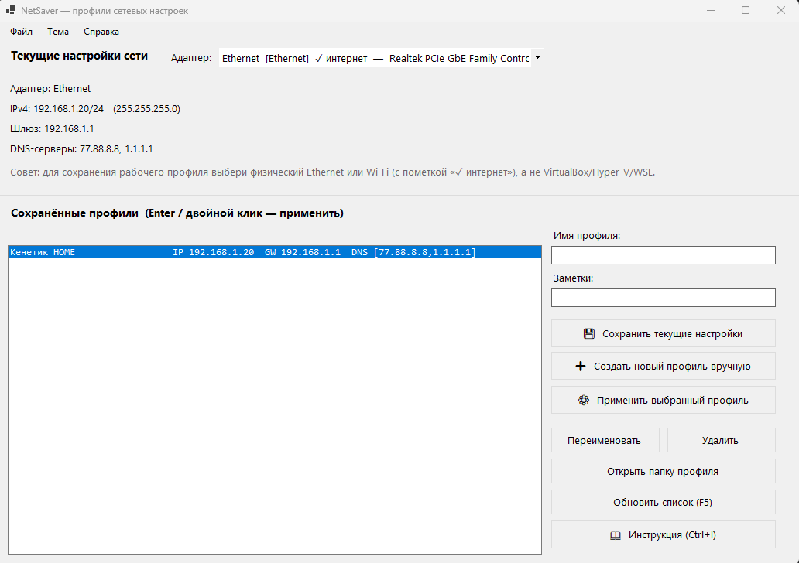
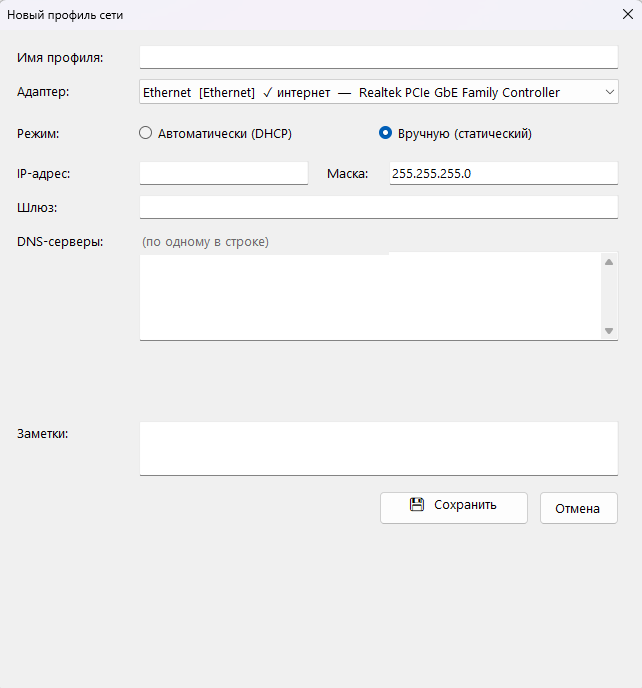
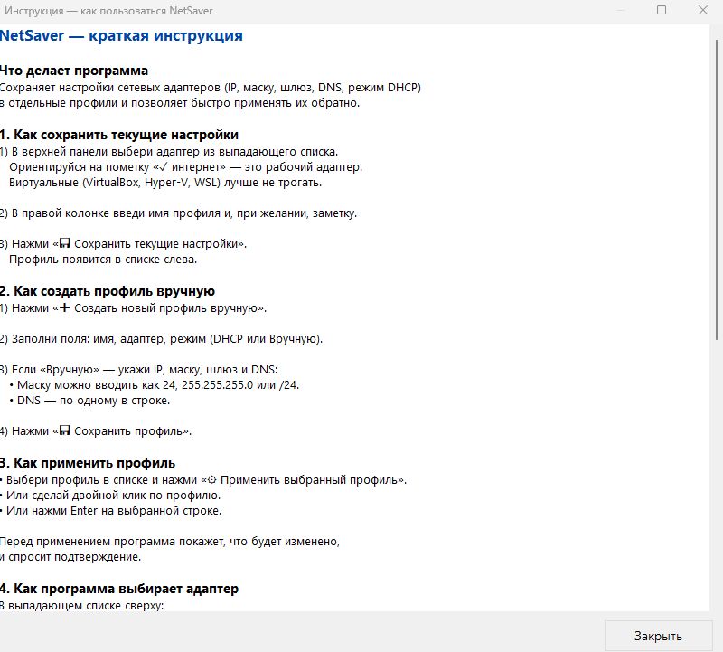
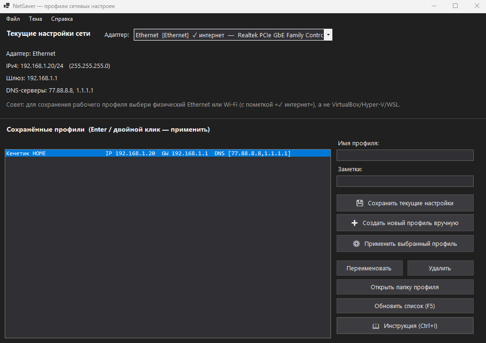

# NetSaver

**NetSaver** — утилита для Windows, которая сохраняет настройки сетевых адаптеров (IP, маска, шлюз, DNS, режим DHCP) в отдельные профили и позволяет быстро применять их обратно. Удобно, когда приходится часто переключаться между сетями: дом, работа, лаборатория, тестовый стенд.



## Возможности

- 📋 **Список активных адаптеров** с пометкой «✓ интернет» — сразу видно, где рабочий физический порт, а где VirtualBox / Hyper-V / WSL.
- 💾 **Сохранение текущего состояния адаптера** в профиль одним нажатием.
- ➕ **Ручное создание профиля** — можно ввести IP, маску, шлюз и DNS вручную.
- ⚙️ **Применение профиля** обратно к системе: DHCP или статика, DNS-серверы.
- 📖 **Встроенная инструкция** (Ctrl+I) — с разделами про сохранение, применение, адаптеры и тему.
- 🌓 **Тёмная / светлая / авто тема** — «авто» следует за настройкой Windows.
- ⌨️ **Горячие клавиши**: Enter, F5, Ctrl+I, Ctrl+D / L / A.
- 📁 **Понятная структура хранения**: каждая сеть - своя папка в `Документы\NetSaver\<имя>\`.

## Как это работает

1. При запуске NetSaver читает список активных сетевых адаптеров через `System.Net.NetworkInformation` — быстро, без внешних процессов.
2. При сохранении профиля настройки выбранного адаптера складываются в `network.json` (для применения) и `info.json` (для человека). Дополнительно сохраняются `ipconfig`, `route print`, `arp -a`, `netstat -ano` в текстовом виде.
3. При применении профиля настройки возвращаются через PowerShell (`New-NetIPAddress`, `Set-DnsClientServerAddress`) — с подтверждением и таймаутом.

## Скриншоты

| Главное окно | Создание профиля |
|:---:|:---:|
|  |  |

| Инструкция | Тёмная тема |
|:---:|:---:|
|  |  |

## Требования

- Windows 10 или 11 (x64)
- [.NET 10 SDK](https://dotnet.microsoft.com/download) — только для сборки из исходников
- Права администратора — нужны для применения профилей

Для запуска готового `.exe` ничего дополнительно ставить не нужно: сборка идёт как self-contained.

## Сборка

```powershell
git clone https://github.com/BSergey2000/NetSaver.git
cd NetSaver
dotnet publish src\NetSaver\NetSaver.csproj -c Release -r win-x64 --self-contained true `
  -p:PublishSingleFile=true -p:IncludeNativeLibrariesForSelfExtract=true
```

Готовый `NetSaver.exe` появится в:

```
src\NetSaver\bin\Release\net10.0-windows\win-x64\publish\NetSaver.exe
```

Один файл, без зависимостей. Можно копировать на любой ПК с Windows x64.

## Использование

1. Запусти `NetSaver.exe` (UAC → «Да»).
2. В верхней панели выбери адаптер с пометкой **✓ интернет**.
3. Введи имя профиля и нажми **💾 Сохранить текущие настройки**.
4. Чтобы вернуть настройки — выбери профиль и нажми **⚙ Применить** (или Enter, или двойной клик).

## Где хранятся профили

```
%USERPROFILE%\Documents\NetSaver\<имя профиля>\
├── network.json        ← настройки для применения
├── info.json           ← человекочитаемое описание
├── ipconfig_all.txt
├── route_print.txt
├── arp_a.txt
└── netstat_ano.txt
```

Настройки темы хранятся отдельно в `%APPDATA%\NetSaver\settings.json`.

## Горячие клавиши

| Клавиша | Действие |
|---|---|
| `Enter` | Применить выбранный профиль |
| Двойной клик | Применить профиль |
| `F5` | Обновить список профилей |
| `Ctrl+I` | Открыть инструкцию |
| `Ctrl+D` | Тёмная тема |
| `Ctrl+L` | Светлая тема |
| `Ctrl+A` | Тема «авто» |

## Структура проекта

```
NetSaver\
├── NetSaver.sln                  ← решение
├── README.md
├── LICENSE
├── .gitignore
├── screenshots\                  ← скриншоты для README
└── src\
    └── NetSaver\
        ├── NetSaver.csproj
        ├── app.manifest          ← запрос прав администратора (UAC)
        ├── Program.cs            ← точка входа, обработка исключений
        ├── MainForm.cs           ← главное окно
        ├── NewProfileForm.cs     ← диалог ручного создания профиля
        ├── InstructionForm.cs    ← окно с инструкцией
        └── ThemeManager.cs       ← светлая/тёмная тема
```

## Безопасность

NetSaver **не отправляет данные** никуда в интернет. Всё, что делает программа:

- читает настройки сетевых адаптеров через .NET;
- сохраняет их в файлы в вашей папке `Документы`;
- применяет их обратно через стандартные командлеты PowerShell.

Программа не модифицирует системные файлы, не ставит драйверы и не лезет в реестр, кроме чтения настройки темы Windows.

## Лицензия

MIT — см. [LICENSE](LICENSE).